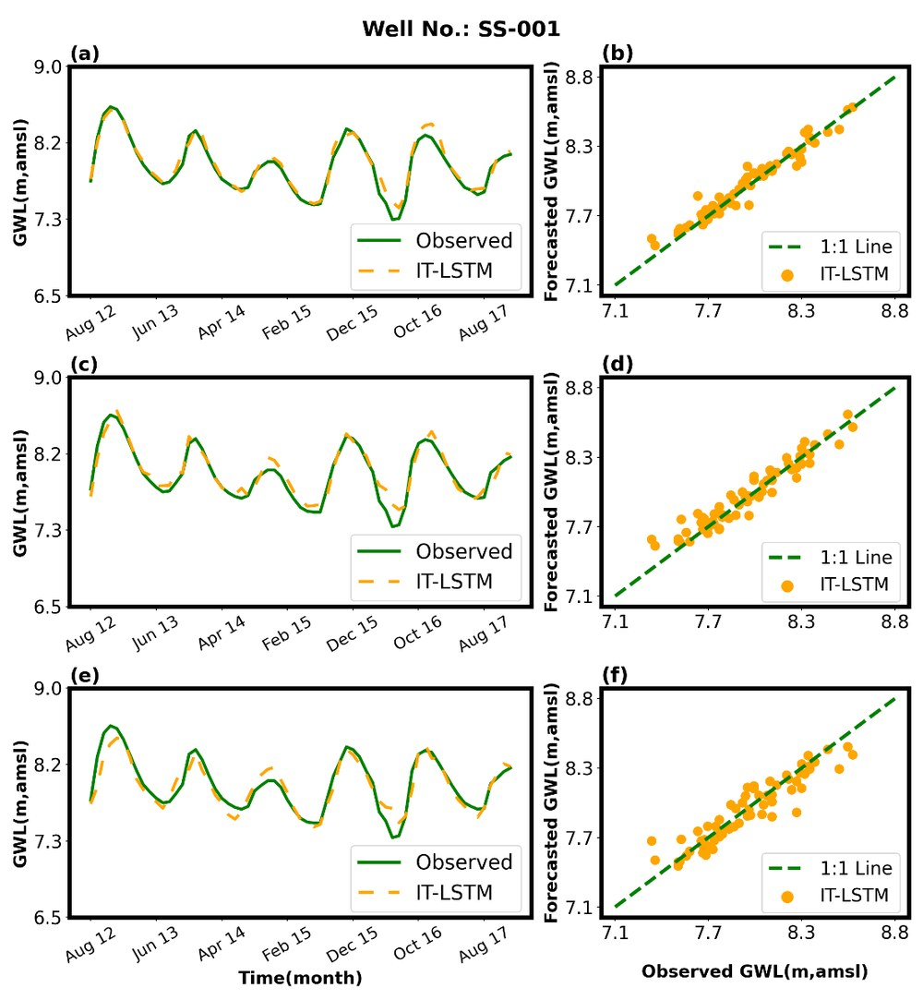

# Groundwater Level Forecasting with LSTM: Single-Well Pipeline

[](https://doi.org/10.1080/02626667.2025.2530120)


A clean, end-to-end notebook that forecasts monthly groundwater level (GWL) 1, 2 and 3 months ahead for a single observation well (SS-001, Kumamoto, Japan) with an LSTM. It is the **independently trained (IT-LSTM) baseline** from:

> **Basin-wide groundwater level forecasting in Kumamoto, Japan: integrating transfer learning with Long Short-Term Memory network**<br>
> A. T. M. Sakiur Rahman, **Shahriar M. Sakib**, M. K. Reza, A. Basak, K. N. Hafiz, M. S. Islam, T. Hosono<br>
> *Hydrological Sciences Journal* 70(14), 2590–2608, 2025 · [paper](https://doi.org/10.1080/02626667.2025.2530120)

➡️ The full study code, including the pre-trained basin model and the transfer-learning (TL-LSTM) experiments, is in [LSTM-based-Time-Series-Forecasting-for-ground-water-Level](https://github.com/Shahriarmsakib/LSTM-based-Time-Series-Forecasting-for-ground-water-Level).

<p align="center">
  
</p>
<p align="center"><sub>Observed (green) vs. IT-LSTM forecast (orange) GWL for well SS-001 at 1, 2 and 3 months ahead, as hydrographs and 1:1 plots (Fig. 4 in the paper). The paper reports test R² of 0.96, 0.92 and 0.86 for this well.</sub></p>

## What the notebook does

`groundwater_prediction_complete.ipynb` walks through the full pipeline:

1. **Setup:** imports (written for Google Colab; the first cell mounts Google Drive).
2. **Data preparation:** loads `SS.001 from 1981-2017.csv`, parses dates and adds calendar features.
3. **Feature selection:** ranks lagged GWL, rainfall, cumulative rainfall and temperature features by mutual information.
4. **Feature subsets:** keeps the top-k features.
5. **Model:** LSTM regressor with an RMSE metric, early stopping and checkpointing.
6. **Sliding windows:** builds input/target arrays.
7. **Horizons:** separate datasets for 1-, 2- and 3-month-ahead targets.
8. **Scaling and split:** min-max scaling and a train/test split.
9. **Training and evaluation:** one model per horizon, scored with R², RMSE and MAE (scikit-learn) and hydrological skill scores (HydroErr).
10. **Export:** saves the models and writes `test_results_S001_{1,2,3}_month.csv`.

## Setup

```bash
pip install tensorflow scikit-learn pandas numpy matplotlib HydroErr
```

The GWL records come from Kumamoto City and are not redistributed here. Place the well's CSV next to the notebook, or edit the path in step 2.

## Citation

```bibtex
@article{rahman2025basin,
  title   = {Basin-wide groundwater level forecasting in Kumamoto, Japan: integrating
             transfer learning with Long Short-Term Memory Network},
  author  = {Rahman, A. T. M. Sakiur and Sakib, Shahriar M. and Reza, Md Kaykobad and
             Basak, Amiya and Hafiz, Khandaker Nusaiba and Islam, Md Shazid and Hosono, Takahiro},
  journal = {Hydrological Sciences Journal},
  volume  = {70},
  number  = {14},
  pages   = {2590--2608},
  year    = {2025},
  doi     = {10.1080/02626667.2025.2530120}
}
```
